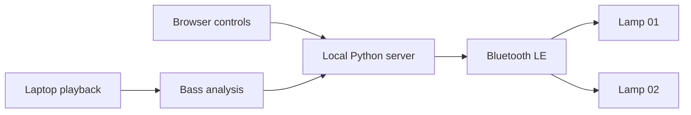

# Cool Lights

**I bought some room lights from Wayfair and wanted to see if I could control them myself. The lights had a preset menu, but I wanted to see if I could sync them to Music, like I have in my Tesla.**

`Local Bluetooth` · `Independent lamp colors` · `Music sync`

## Why this exists

I wanted to push the boundaries of what an agent could do: move beyond writing code, understand the devices around me, and connect software to something physical in my apartment.

The experiment started with a question: could an agent help find my Bluetooth lights, connect to them, and make them work with another system—music playback? Together, we scanned for nearby devices, identified my lamps by unplugging and reconnecting them, inspected their Bluetooth services, and tested a color command. When a lamp turned red, we had a working connection to build on.

That became Cool Lights: two ordinary floor lamps, a laptop, a small web interface, and audio-reactive lighting. No cloud connection is needed to control the lamps.

## The lights

> **The lamps used in this project:** [Ivy Bronx 57.9-inch column corner floor lamps with 16 million colors, set of two, purchased from Wayfair](https://www.wayfair.com/lighting/pdp/ivy-bronx-579inch-tall-column-corner-floor-lamp-with-16-million-colors-set-of-2-w113552328.html?auctionId=798004d9-36a0-45ad-a4c3-503004941ab3&trackingId=%7B%22adType%22%3A%22WSP%22%2C%22auctionId%22%3A%22798004d9-36a0-45ad-a4c3-503004941ab3%22%7D&adTypeId=1&l=6238)

The tested units advertise as **`MELK-OA10WCT`**. The connection and color protocol were verified on these two lamps; other products with similar names may behave differently.

## What it does

- **Individual colors:** control Lamp 01, Lamp 02, or both using presets, a color picker, or a hex value.
- **24 animated presets:** a 4-column × 6-row gallery, with speed or tempo controls and one-click stop.
- **Music sync:** pulse both lamps with the bass while preserving each lamp's selected color. Ocean stays Ocean; Red stays Red.
- **Adjustable response:** set sensitivity, maximum brightness, and the requested Bluetooth update rate.
- **Manual override:** applying a color or turning a lamp dark stops music sync before sending the change.
- **Local state:** remember each lamp's last successfully sent color across server restarts.

The interface uses a compact card layout, with Colors and Music sync tabs in smaller windows.

### Animated presets

In the Colors card, use the Presets menu to switch between **Animations** and **Solid colors**. Choose Lamp 01, Lamp 02, or both, then click an animation. Slow, Normal, and Fast adjust timer-driven animations. BPM instead offers a manual 40–200 BPM tempo (default 120); this is not automatic beat detection. DJ Light and Freqwave respond to laptop playback and share Music sync’s sensitivity and maximum brightness controls. Stop animation restores the selected lamps' saved static colors.

The table follows the gallery’s left-to-right, top-to-bottom order. Hex values show palette stops; procedural and audio presets generate colors dynamically. Color schemes describe changes over time across the whole lamp.

| Preset ID | Name | Color scheme |
| --- | --- | --- |
| `aurora` | Aurora | Emerald → teal → blue → violet<br>`#19E6A1` · `#18AFC9` · `#2848B8` · `#A35CE0` |
| `sunset` | Sunset | Amber → coral → pink → twilight violet<br>`#FFAE45` · `#FF6249` · `#DF458E` · `#6D42AF` |
| `ocean` | Ocean Drift | Deep blue → ocean blue → teal → pale aqua<br>`#133C97` · `#087FB0` · `#24C8BA` · `#A3E1E8` |
| `rainbow` | Rainbow | Full hue wheel at 88% saturation |
| `breathe` | Breathe | Each lamp’s saved color, dimmed and brightened |
| `candle` | Candle | Warm amber with softly varying orange and gold |
| `android` | Android | Green → teal → violet<br>`#33FF66` · `#19BDB0` · `#6555FF` |
| `black-hole` | Black Hole | Midnight blue → deep violet → lavender white<br>`#03051A` · `#281066` · `#571CA8` · `#CCD8FF` |
| `blends` | Blends | Pink → amber → turquoise → purple<br>`#FF568B` · `#FFBE56` · `#36D3BE` · `#7165EB` |
| `bpm` | BPM | Magenta → violet → turquoise → gold<br>`#EE287D` · `#734CEE` · `#24D9C6` · `#FFD45E` |
| `chunchun` | Chunchun | Pastel pink → aqua → lavender<br>`#F494BC` · `#86DAD5` · `#B49BF1` |
| `colored-bursts` | Colored Bursts | Coral pink → sky blue → yellow → violet<br>`#FF5378` · `#56CFF5` · `#FFCD57` · `#B35EFF` |
| `colorful` | Colorful | Red → amber → green → blue<br>`#EF394F` · `#FFB83F` · `#38D273` · `#3989ED` |
| `dna` | DNA | Rotating complementary hues with crossing brightness waves |
| `dj-light` | DJ Light | Audio-driven RGB: bass → red, mids → green, treble → blue |
| `dna-spiral` | DNA Spiral | Rotating complementary hues at a slower cycle than DNA |
| `freqwave` | Freqwave | Dominant playback frequency selects hue; energy sets brightness |
| `ps-vortex` | PS Vortex | Layered full-hue cycles at 80% saturation |
| `candy-cane` | Candy Cane | Red → creamy white → pink → icy blue<br>`#F02A48` · `#FFF1DD` · `#F49EC3` · `#9DDFEF` |
| `halloween` | Halloween | Orange → violet → eerie green → deep purple<br>`#FF6C18` · `#6022AE` · `#8CBF28` · `#2F124F` |
| `merry-christmas` | Merry Christmas | Red → evergreen → gold → warm white<br>`#D92636` · `#176B3A` · `#F9BB49` · `#FFF0CB` |
| `fire-2012` | Fire 2012 | Red-orange embers → orange flame → golden peaks |
| `pacifica` | Pacifica | Deep navy → ocean blue → teal → pale seafoam<br>`#041B4B` · `#075D89` · `#11999A` · `#8BD5CA` |
| `plasma` | Plasma | Overlapping full-hue cycles at 80% saturation |

These are original interpretations of familiar lighting concepts found in [WLED effects](https://kno.wled.ge/features/effects/) and [palettes](https://kno.wled.ge/features/palettes/), and inspired by aurora/sunset scenes highlighted in the [Philips Hue gallery](https://www.philips-hue.com/en-gb/explore-hue/apps/bridge). They are not exact copies of those systems' scenes. [Research and source notes](docs/preset-research.md) explain the selection.

Animations use the verified whole-lamp RGB command at up to 20 paired updates/s. When both lamps are selected, their palette phases are offset. The gradient swatches represent color transitions over time, not separately controlled sections of a lamp. Pixel/segment gradients and native firmware animation IDs remain unverified on these units and are not exposed as working features. No rapid-strobe presets are included.

The animation view replaces the custom color inputs with all 24 presets in one 4-by-6 gallery. Switch to Solid colors to use the color picker and hex input.

DJ Light maps bass, mids, and treble to RGB; Freqwave maps the dominant playback frequency to hue and energy to brightness. Both use the default playback monitor, never a microphone. NumPy analyzes a rolling **256-sample / 32 ms** frequency window at 8 kHz, refreshed every **20 ms**, while the existing bass analyzer retains **5 ms** blocks. Silence fades down; capture failure stops the effect and restores static colors. These are separate analysis windows, not end-to-end latency measurements.

The laptop must stay running for these effects. Animations and music sync use exclusive Bluetooth control: starting either stops the other, and applying a static color or Turn off stops animations first. Effects never overwrite the saved static colors.

## How it works



The Python server serves the frontend and uses [Bleak](https://bleak.readthedocs.io/en/latest/) to talk to the lamps through Linux's Bluetooth stack. Music sync captures the current audio output's monitor using `parec`, analyzes bass energy in memory, and sends brightness-scaled RGB values over two persistent connections.

The microphone is not used. Audio is not saved or uploaded. Music played separately on a phone is not captured unless it is routed through the laptop's audio output.

## Run locally

The tested setup is a Lenovo ThinkPad E14 running Linux with BlueZ and PipeWire's PulseAudio compatibility service.

You need:

- Python **3.11+**, with `venv` and pip.
- Node.js **24+** and npm for Portless.
- A working Bluetooth adapter and BlueZ service.
- `pactl` and `parec` on your PATH for music sync.
- The lamps powered on and within Bluetooth range.

From the project directory:

```bash
npm ci
npm start
```

The first start creates `.venv` and installs the pinned Python dependency. Open **[cool-lights.localhost:1355](http://cool-lights.localhost:1355)**, or use **[localhost:8765](http://localhost:8765)** directly.

Press **Ctrl+C** in the server terminal to stop the app. Stopping music sync restores the saved lamp colors before releasing its connections. Closing the browser tab alone does not stop sync.

### Configure your lamps

The `LAMPS` mapping near the top of [`scripts/server.py`](scripts/server.py) contains the two tested Bluetooth addresses. Replace those addresses when using a different pair.

To discover and inspect devices:

```text
bluetoothctl
scan on
info <device-address>
scan off
quit
```

A Bluetooth scan finds nearby advertising or discoverable devices; it is not your router's Wi-Fi client list. Results may include neighbors' devices. To identify your own lamps, unplug one from power, compare fresh scan activity, and reconnect it. Turning off only the LEDs with the remote may leave the controller advertising.

The tested control characteristic is `0000fff3-0000-1000-8000-00805f9b34fb`, supporting writes without response. The verified RGB frame is:

```text
7e 07 05 03 RR GG BB 10 ef
```

Colors are stored locally in `.lamp-colors.json`, which is excluded from version control. Music settings and connection status reset when the server restarts. “Turn off” sends black; it does not cut electrical power. Soft white is mixed RGB, not a separate white-temperature channel.

## A local name with Vercel Portless

[Vercel Portless](https://github.com/vercel-labs/portless) gives the application a stable local name:

```text
http://cool-lights.localhost:1355 → http://localhost:8765
```

Portless is pinned as a project dependency. Startup registers a persistent alias for the Python server. The proxy uses HTTP on port **1355** so it can run without an administrator password, certificate installation, or changes to the system hosts file. Chrome/Chromium, Firefox, and Edge resolve `.localhost` names locally.

## Music sync: response and limits

Audio is analyzed in **5 ms blocks**, carrying filter state across blocks. A fast attack and softer decay translate bass energy into brightness. Silence leaves a dim glow. Both lamps receive their own RGB color scaled by the same audio level.

The requested update rate ranges from **10 to 60 Hz**. The sender skips overdue scheduling slots instead of queuing stale colors. Higher rates are experimental: Bluetooth conditions and lamp firmware can limit visible responsiveness.

During this experiment, the original loop sent about **9.7 paired updates per second**. After reducing capture buffering and improving scheduling, a later live check measured **58 completed paired writes per second** with a 60 Hz target. Audio analysis averaged about 200 blocks per second, and PipeWire reported a roughly 5.4 ms capture buffer.

Those are **host-side software measurements**, not measurements of radio delivery, visible LED refresh, or total audio-to-light latency. Short tests without write errors do not establish long-term reliability. The UI exposes update rate and write timing to help diagnose the current session.

### Troubleshooting

| Symptom | Check |
| --- | --- |
| Lamp not found or connection fails | Check power, move the laptop closer, and close other lamp controllers. |
| Music sync fails | Read the status message; confirm both lamps are available. |
| No reaction to music | Play audio on this laptop and check the bass meter. After changing audio outputs, stop and restart sync. |
| Motion looks flat | Reduce sensitivity or maximum brightness; try music with distinct bass hits. |
| Higher rates look worse | Lower the update-rate slider. Accepted Bluetooth writes do not prove every frame was displayed. |
| Named URL fails | Try port 8765 directly, then run `npm run name`. |
| Controls ask for a reload | Reload after restarting the server; each process creates a new request token. |

## Project map

```text
front-end/    HTML, CSS, and browser controls
scripts/      Local server, Bluetooth/audio logic, and launch scripts
tests/        Audio-response and color-preservation tests
AGENTS.md     Navigation and operating guidance for agents
```

Run the checks after installing dependencies and starting the app at least once to create `.venv`:

```bash
npm test
bash -n scripts/start.sh scripts/name.sh
```

The automated checks do not connect to lamps, record audio, or play sound. Browser layout and physical lamp behavior require separate verification.

## References

- [The purchased lamps on Wayfair](https://www.wayfair.com/lighting/pdp/ivy-bronx-579inch-tall-column-corner-floor-lamp-with-16-million-colors-set-of-2-w113552328.html)
- [Vercel Portless](https://github.com/vercel-labs/portless) and [its command documentation](https://portless.sh/commands)
- [Bleak Bluetooth client documentation](https://bleak.readthedocs.io/en/latest/api/client.html)
- [BlueZ's GATT command documentation](https://github.com/bluez/bluez/blob/master/doc/bluetoothctl-gatt.rst)
- [MELK-OA10 protocol research used for the first color command](https://github.com/wporter82/lotus-lamp-python/blob/main/docs/PROTOCOL.md)

The protocol research covers a related controller. Compatibility with the two lamps here was established by testing, not by their product names alone.
