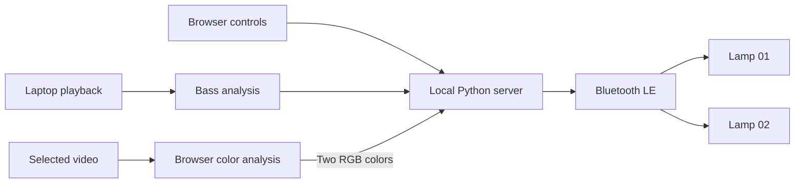

# Cool Lights

**I bought some room lights from Wayfair and wanted to see if I could control them myself. The lights had a preset menu, but I wanted to see if I could sync them to Music, like I have in my Tesla.**

`Local Bluetooth` · `Music sync` · `Media sync` · `On-lamp animations`

[Run locally](#run-locally) · [Music & media](#music--media-sync) · [Presets](#presets) · [Shutdown behavior](#shutdown-behavior) · [Portless](#a-local-name-with-vercel-portless)

## Why this exists

I wanted to push the boundaries of what an agent could do: move beyond writing code, understand the devices around me, and connect software to something physical in my apartment.

The experiment started with a question: could an agent help find my Bluetooth lights, connect to them, and make them work with another system—music playback? Together, we scanned for nearby devices, identified my lamps by unplugging and reconnecting them, inspected their Bluetooth services, and tested a color command. When a lamp turned red, we had a working connection to build on.

That became Cool Lights: two ordinary floor lamps, a laptop, a small web interface, audio-reactive lighting, and screen-matched colors. No cloud connection is needed to control the lamps.

## The lights

> **The lamps used in this project:** [Ivy Bronx 57.9-inch column corner floor lamps with 16 million colors, set of two, purchased from Wayfair](https://www.wayfair.com/lighting/pdp/ivy-bronx-579inch-tall-column-corner-floor-lamp-with-16-million-colors-set-of-2-w113552328.html?auctionId=798004d9-36a0-45ad-a4c3-503004941ab3&trackingId=%7B%22adType%22%3A%22WSP%22%2C%22auctionId%22%3A%22798004d9-36a0-45ad-a4c3-503004941ab3%22%7D&adTypeId=1&l=6238)

The tested units advertise as **`MELK-OA10WCT`**. The connection and color protocol were verified on these two lamps; other products with similar names may behave differently.

## What it does

- **Individual colors:** control Lamp 01, Lamp 02, or both using presets, a color picker, or a hex value.
- **On-lamp Rainbow Flow:** a built-in gradual color cycle, visually confirmed on Lamp 01 to continue after the sender disconnects and exits.
- **24 laptop animated presets:** a 4-column × 6-row gallery, with speed or tempo controls and one-click stop.
- **Media sync:** gently match left/right video colors from a selected browser capture, with brightness, smoothing, and lamp-swap controls.
- **Music sync:** pulse both lamps with the bass while preserving each lamp's selected color. Ocean stays Ocean; Red stays Red.
- **Adjustable response:** set sensitivity, maximum brightness, and the requested Bluetooth update rate.
- **Manual override:** applying a color or turning a lamp dark stops music sync before sending the change.
- **Local state:** remember each lamp's last successfully sent color across server restarts.

The interface uses a compact card layout, with Colors and Sync tabs in smaller windows. The Sync card has visible **Music** and **Media** buttons.

## Music & media sync

Choose **Music** or **Media** in the Sync card. Both control the same pair of lamps; starting a different lighting mode ends the current sync session.

| Feature | Music | Media |
| --- | --- | --- |
| **Follows** | Bass in the laptop’s playback audio | Colors in a selected video window or display |
| **Lamp colors** | Keeps each lamp’s chosen color | Lamp 01 follows the left half; Lamp 02 follows the right |
| **Controls** | Sensitivity, maximum brightness, update rate | Maximum brightness, smoothing, swap left/right |
| **Keep running** | Python server; browser may close | Python server and the capture browser tab |
| **Privacy** | Playback monitor only; no microphone | Local frame analysis; only two RGB colors reach the server |

### Music: pulse in your own colors

1. Set each lamp’s color in **Colors**—for example, Ocean on Lamp 01 and Red on Lamp 02.
2. In **Sync → Music**, click **Start music sync** and play audio on the laptop.
3. Adjust **Sensitivity** for the bass response, **Max brightness** for intensity, and **Update rate** for the requested send frequency.

Ocean stays Ocean; Red stays Red. The soundtrack changes their brightness rather than replacing the colors. This works with audio from music players, YouTube, movies, or sports played through the laptop’s output. Audio from an independent TV or phone is not captured unless routed through the laptop. After changing audio outputs, stop and restart sync.

For changing audio-driven colors instead, choose **DJ Light** or **Freqwave** under **Laptop animations**. DJ Light maps bass, mids, and treble to RGB; Freqwave maps dominant frequency to hue. They share Music’s sensitivity and maximum-brightness settings.

<details>
<summary>Music processing and measured performance</summary>

Bass analysis uses **5 ms blocks**, carrying filter state across blocks. A fast attack and softer decay translate bass energy into brightness; silence leaves a dim glow. DJ Light and Freqwave additionally use a rolling **32 ms** frequency window, refreshed every **20 ms**.

The requested music update rate is **10–60 Hz**. Overdue slots are skipped rather than queued. During earlier development, host-side paired writes improved from about **9.7/s** to **58/s** in a short check with a 60 Hz target. Analysis averaged about 200 blocks/s, and PipeWire reported roughly 5.4 ms capture buffering. These are historical software measurements, not guaranteed throughput, visible LED refresh, or end-to-end audio latency. The current UI exposes update rate and write timing.

</details>

### Media: match the picture

1. In **Sync → Media**, click **Choose screen or window**.
2. Use the browser’s sharing picker to select the actual video window or a display connected to the laptop.
3. Click **Start media sync**. Keep the Cool Lights tab open while watching; you can switch to the video tab.

Choosing or cancelling a source alone does not send lamp commands. Use **Swap left and right lamps** if the physical lamp placement is reversed. Dark scenes dim the lights; this mode adds no soundtrack pulses.

| Setting | Default | Effect |
| --- | --- | --- |
| Maximum brightness | **50%** | Caps the room’s light output |
| Smoothing | **350 ms** | Softens color changes; lower values respond faster |
| Paired send ceiling | **10 updates/s** | Drops stale colors instead of building a backlog |

**Media sync is currently an ambient color wash, with noticeable smoothing delay.** At the default 350 ms exponential smoothing, a color change takes about **0.8 seconds to reach 90%** of its target, before capture, transport, and Bluetooth delays. Lower the smoothing control toward its **100 ms** minimum for a quicker response. The current release retains its 10 updates/s ceiling; frame-accurate matching is not promised.

<details>
<summary>Capture, browser support, and lifecycle</summary>

A background worker analyzes downscaled **160 × 90** frames, trims detected outer black bars, averages each half in linear light, and smooths the results. Only two RGB hex colors are sent to the local server, which holds both Bluetooth connections. No video images are sent to the server, saved, or uploaded. Transient colors never overwrite saved static colors.

Use a desktop browser supporting screen sharing, video-frame processing, transferable streams or tracks, and `OffscreenCanvas`. Capabilities are checked at runtime; unsupported browsers show an error rather than silently relying on foreground-only capture. Select the video rather than the Cool Lights window to avoid feedback from its preview. Capture-protected video may be blank or unavailable; the app does not bypass playback protection. TV-native apps are outside this mode’s scope.

| Action | Result |
| --- | --- |
| Click **Stop media sync** | End capture and restore saved static colors |
| Close the capture tab or stop browser sharing | Disconnect and retain the last displayed colors |
| No color updates for two seconds | Release Bluetooth; covers a tab crash or stalled capture |
| Stop the Python server | End live matching without a final color reset |
| Apply another color, animation, or sync mode | End media sync and switch to the requested lighting |

Automated tests cover synthetic colors, worker delivery, authenticated HTTP sessions, and Bluetooth lifecycle using simulated lamps. Background-tab/fullscreen capture, external displays, and precise visible timing require checks on the browser and hardware in use. Host-side update counts do not measure optical latency.

References: [screen sharing](https://developer.mozilla.org/en-US/docs/Web/API/MediaDevices/getDisplayMedia), [video-frame processor support](https://developer.mozilla.org/en-US/docs/Web/API/MediaStreamTrackProcessor).

</details>

## Presets

| On-lamp preset | Color scheme | After server shutdown |
| --- | --- | --- |
| **Rainbow Flow** (`rainbow-flow`) | Built-in gradual multicolor cycle | Continues on the lamp |

In the Colors card, use the Presets menu to choose **On-lamp animations**, **Laptop animations**, or **Solid colors**. **Rainbow Flow** runs inside the lamp: the app sends mode 199 once, disconnects, and exits without a color restore. It keeps animating after server shutdown. Use a solid color or Turn off to replace it. Lamp 01’s standalone behavior was visually confirmed by the owner; Lamp 02 has not yet been visually checked for this mode.

The 24 **Laptop animations** below run on the computer and stop when its server stops. For those presets, choose Lamp 01, Lamp 02, or both, then click an animation. Slow, Normal, and Fast adjust timer-driven animations. BPM instead offers a manual 40–200 BPM tempo (default 120); this is not automatic beat detection. DJ Light and Freqwave respond to laptop playback and share Music sync’s sensitivity and maximum brightness controls. Stop animation restores the selected lamps' saved static colors.

The table follows the gallery’s left-to-right, top-to-bottom order. Hex values show palette stops; procedural and audio presets generate colors dynamically. Color schemes describe changes over time across the whole lamp.

<details>
<summary>Explore all 24 laptop presets and color schemes</summary>

| Preset ID | Name | Color scheme |
| --- | --- | --- |
| `aurora` | Aurora | Emerald → teal → blue → violet<br>`#19E6A1` · `#18AFC9` · `#2848B8` · `#A35CE0` |
| `sunset` | Sunset | Amber → coral → pink → twilight violet<br>`#FFAE45` · `#FF6249` · `#DF458E` · `#6D42AF` |
| `ocean` | Ocean Drift | Deep blue → ocean blue → teal → pale aqua<br>`#133C97` · `#087FB0` · `#24C8BA` · `#A3E1E8` |
| `rainbow` | Rainbow | Full hue wheel at 88% saturation |
| `breathe` | Breathe | Each lamp’s saved color, dimmed and brightened |
| `candle` | Candle | Warm amber with softly varying orange and gold |
| `android` | Android | Green → teal → violet<br>`#33FF66` · `#19BDB0` · `#6555FF` |
| `black-hole` | Black Hole | Midnight blue → deep violet → lavender white<br>`#03051A` · `#281066` · `#571CA8` · `#CCD8FF` |
| `blends` | Blends | Pink → amber → turquoise → purple<br>`#FF568B` · `#FFBE56` · `#36D3BE` · `#7165EB` |
| `bpm` | BPM | Magenta → violet → turquoise → gold<br>`#EE287D` · `#734CEE` · `#24D9C6` · `#FFD45E` |
| `chunchun` | Chunchun | Pastel pink → aqua → lavender<br>`#F494BC` · `#86DAD5` · `#B49BF1` |
| `colored-bursts` | Colored Bursts | Coral pink → sky blue → yellow → violet<br>`#FF5378` · `#56CFF5` · `#FFCD57` · `#B35EFF` |
| `colorful` | Colorful | Red → amber → green → blue<br>`#EF394F` · `#FFB83F` · `#38D273` · `#3989ED` |
| `dna` | DNA | Rotating complementary hues with crossing brightness waves |
| `dj-light` | DJ Light | Audio-driven RGB: bass → red, mids → green, treble → blue |
| `dna-spiral` | DNA Spiral | Rotating complementary hues at a slower cycle than DNA |
| `freqwave` | Freqwave | Dominant playback frequency selects hue; energy sets brightness |
| `ps-vortex` | PS Vortex | Layered full-hue cycles at 80% saturation |
| `candy-cane` | Candy Cane | Red → creamy white → pink → icy blue<br>`#F02A48` · `#FFF1DD` · `#F49EC3` · `#9DDFEF` |
| `halloween` | Halloween | Orange → violet → eerie green → deep purple<br>`#FF6C18` · `#6022AE` · `#8CBF28` · `#2F124F` |
| `merry-christmas` | Merry Christmas | Red → evergreen → gold → warm white<br>`#D92636` · `#176B3A` · `#F9BB49` · `#FFF0CB` |
| `fire-2012` | Fire 2012 | Red-orange embers → orange flame → golden peaks |
| `pacifica` | Pacifica | Deep navy → ocean blue → teal → pale seafoam<br>`#041B4B` · `#075D89` · `#11999A` · `#8BD5CA` |
| `plasma` | Plasma | Overlapping full-hue cycles at 80% saturation |

</details>

These are original interpretations of familiar lighting concepts found in [WLED effects](https://kno.wled.ge/features/effects/) and [palettes](https://kno.wled.ge/features/palettes/), and inspired by aurora/sunset scenes highlighted in the [Philips Hue gallery](https://www.philips-hue.com/en-gb/explore-hue/apps/bridge). They are not exact copies of those systems' scenes. [Research and source notes](docs/preset-research.md) explain the selection.

Animations use the verified whole-lamp RGB command at up to 20 paired updates/s. When both lamps are selected, their palette phases are offset. The gradient swatches represent color transitions over time, not separately controlled sections of a lamp. Pixel/segment addressing remains unverified. Rainbow Flow is the separately tested native mode; the 24 custom laptop effects are not uploaded to the lamp firmware. No rapid-strobe presets are included.

The animation view replaces the custom color inputs with all 24 presets in one 4-by-6 gallery. Switch to Solid colors to use the color picker and hex input.

The laptop must stay running for the 24 custom laptop effects and playback music sync. Rainbow Flow runs independently on the lamp. Animations and music sync use exclusive Bluetooth control: starting either stops the other, and applying a static color or Turn off stops animations first. Effects never overwrite the saved static colors.

## Shutdown behavior

Two changes make color retention and autonomous animation possible:

1. **Shutdown no longer resets the color.** Previously, stopping the server ran the same cleanup as the in-app Stop button, sending each lamp its saved static color and replacing the current frame. The server now sets `SHUTTING_DOWN` before cancelling its tasks. Cleanup still stops audio capture and disconnects Bluetooth, but skips those final RGB restore writes. The owner confirmed that colors stayed on after shutting down the updated server. Saved static colors in `.lamp-colors.json` remain separate from animation frames.
2. **Rainbow Flow runs inside the lamp.** Instead of streaming RGB frames from Python, the app writes native mode 199 once (`7e 07 03 c7 ff ff ff 00 ef`) to the control characteristic, waits briefly, and disconnects. The lamp’s own firmware generates subsequent frames. The owner confirmed that Lamp 01 kept animating after the standalone sender disconnected and exited. No background server, open browser, or persistent Bluetooth connection is needed for that mode.

| Active lighting | After closing the browser | After stopping the server |
| --- | --- | --- |
| Solid color | Stays on | Last color remains |
| On-lamp **Rainbow Flow** | Keeps animating | Keeps animating on the lamp |
| One of the 24 laptop animations | Keeps animating while server runs | Freezes on the last RGB frame |
| Laptop music sync, DJ Light, or Freqwave | Continues while server runs | Audio response stops; last RGB frame remains, possibly dim |
| Media sync | Capture ends; last colors remain | Live matching stops; last colors remain |

The in-app **Stop animation** / **Stop music sync** / **Stop media sync** controls deliberately retain their original behavior: restore the saved static colors. Choose a solid color or Turn off to replace an on-lamp animation. Closing the browser alone leaves the Python server running. Ctrl+C and SIGTERM use the new graceful shutdown path.

These checks establish color retention on the tested setup and native animation retention on Lamp 01. Lamp 02’s Rainbow Flow behavior and retention after unplugging or loss of power have not been visually verified. The custom laptop presets are not uploaded into firmware and cannot animate autonomously.

## How it works



The Python server serves the frontend and uses [Bleak](https://bleak.readthedocs.io/en/latest/) to talk to the lamps through Linux's Bluetooth stack. Music sync captures the current audio output's monitor using `parec`, analyzes bass energy in memory, and sends brightness-scaled RGB values over two persistent connections.

The microphone is not used. Audio is not saved or uploaded. Music played separately on a phone is not captured unless it is routed through the laptop's audio output.

## Run locally

The tested setup is a Lenovo ThinkPad E14 running Linux with BlueZ and PipeWire's PulseAudio compatibility service.

You need:

- Python **3.11+**, with `venv` and pip.
- Node.js **24+** and npm for Portless.
- A working Bluetooth adapter and BlueZ service.
- `pactl` and `parec` on your PATH for music sync.
- The lamps powered on and within Bluetooth range.

From the project directory:

```bash
npm ci
npm start
```

The first start creates `.venv` and installs the pinned Python dependencies. Open **[cool-lights.localhost:1355](http://cool-lights.localhost:1355)**, or use **[localhost:8765](http://localhost:8765)** directly.

Press **Ctrl+C** in the server terminal to stop the app without a final color reset. The in-app Stop music sync button restores saved lamp colors; server shutdown leaves the last frame untouched. Closing the browser tab alone does not stop Music sync; it does stop browser-based Media sync.

### Configure your lamps

The `LAMPS` mapping near the top of [`scripts/server.py`](scripts/server.py) contains the two tested Bluetooth addresses. Replace those addresses when using a different pair.

To discover and inspect devices:

```text
bluetoothctl
scan on
info <device-address>
scan off
quit
```

A Bluetooth scan finds nearby advertising or discoverable devices; it is not your router's Wi-Fi client list. Results may include neighbors' devices. To identify your own lamps, unplug one from power, compare fresh scan activity, and reconnect it. Turning off only the LEDs with the remote may leave the controller advertising.

The tested control characteristic is `0000fff3-0000-1000-8000-00805f9b34fb`, supporting writes without response. The verified RGB frame is:

```text
7e 07 05 03 RR GG BB 10 ef
```

Colors are stored locally in `.lamp-colors.json`, which is excluded from version control. Music settings and connection status reset when the server restarts. “Turn off” sends black; it does not cut electrical power. Soft white is mixed RGB, not a separate white-temperature channel.

## A local name with Vercel Portless

[Vercel Portless](https://github.com/vercel-labs/portless) gives the application a stable local name:

```text
http://cool-lights.localhost:1355 → http://localhost:8765
```

Portless is pinned as a project dependency. Startup registers a persistent alias for the Python server. The proxy uses HTTP on port **1355** so it can run without an administrator password, certificate installation, or changes to the system hosts file. Chrome/Chromium, Firefox, and Edge resolve `.localhost` names locally.

## Troubleshooting

| Symptom | Check |
| --- | --- |
| Lamp not found or connection fails | Check power, move the laptop closer, and close other lamp controllers. |
| Music sync fails | Read the status message; confirm both lamps are available. |
| No reaction to music | Play audio on this laptop and check the bass meter. After changing audio outputs, stop and restart sync. |
| Motion looks flat | Reduce sensitivity or maximum brightness; try music with distinct bass hits. |
| Higher rates look worse | Lower the update-rate slider. Accepted Bluetooth writes do not prove every frame was displayed. |
| Named URL fails | Try port 8765 directly, then run `npm run name`. |
| Controls ask for a reload | Reload after restarting the server; each process creates a new request token. |
| Cannot find Media sync | In the Sync card, click the **Media** button beside Music; refresh if viewing an older page. |
| Start media sync is disabled | Choose a screen or window first; Start enables when video frames arrive. |
| Media colors trail the video | Lower smoothing; this release is capped at 10 updates/s and is not frame-accurate. |
| Media reports no frames or unsupported browser | Try another source or a current compatible desktop browser; protected content may be unavailable. |

## Project map

```text
front-end/    HTML, CSS, and browser controls
scripts/      Local server, Bluetooth/audio/media controllers, and launch scripts
tests/        Audio, media color/worker, HTTP, and lifecycle checks
AGENTS.md     Navigation and operating guidance for agents
```

Run the checks after installing dependencies and starting the app at least once to create `.venv`:

```bash
npm test
bash -n scripts/start.sh scripts/name.sh
```

The automated checks do not connect to lamps, record audio, or play sound. Browser layout and physical lamp behavior require separate verification.

## References

- [The purchased lamps on Wayfair](https://www.wayfair.com/lighting/pdp/ivy-bronx-579inch-tall-column-corner-floor-lamp-with-16-million-colors-set-of-2-w113552328.html)
- [Vercel Portless](https://github.com/vercel-labs/portless) and [its command documentation](https://portless.sh/commands)
- [Bleak Bluetooth client documentation](https://bleak.readthedocs.io/en/latest/api/client.html)
- [BlueZ's GATT command documentation](https://github.com/bluez/bluez/blob/master/doc/bluetoothctl-gatt.rst)
- [MELK-OA10 protocol research used for the first color command](https://github.com/wporter82/lotus-lamp-python/blob/main/docs/PROTOCOL.md)

The protocol research covers a related controller. Compatibility with the two lamps here was established by testing, not by their product names alone.
